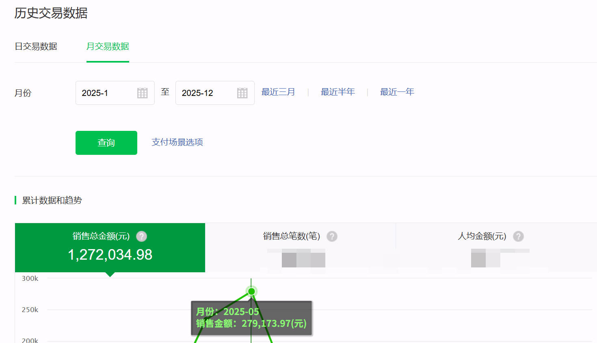
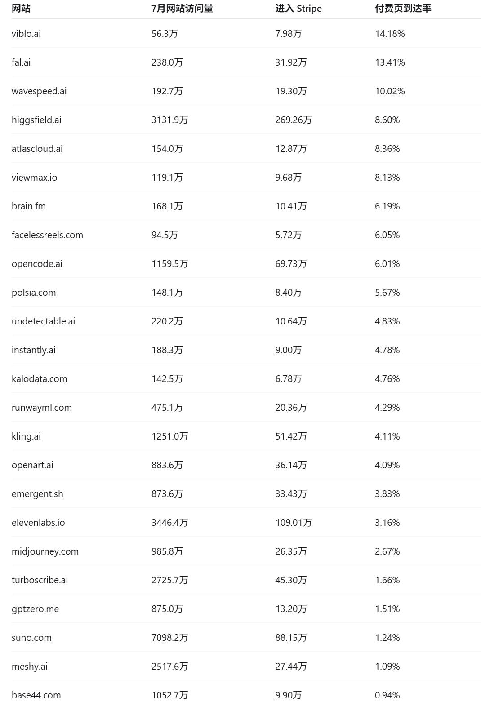
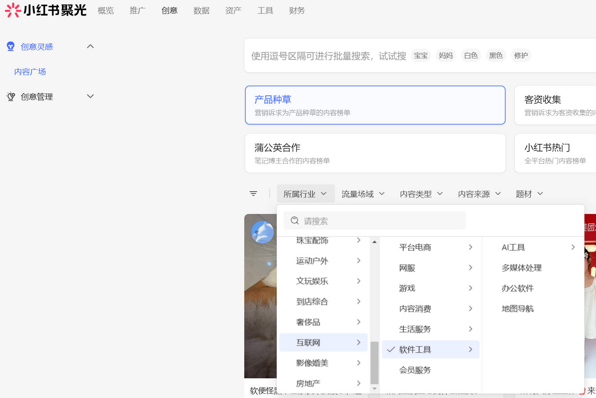
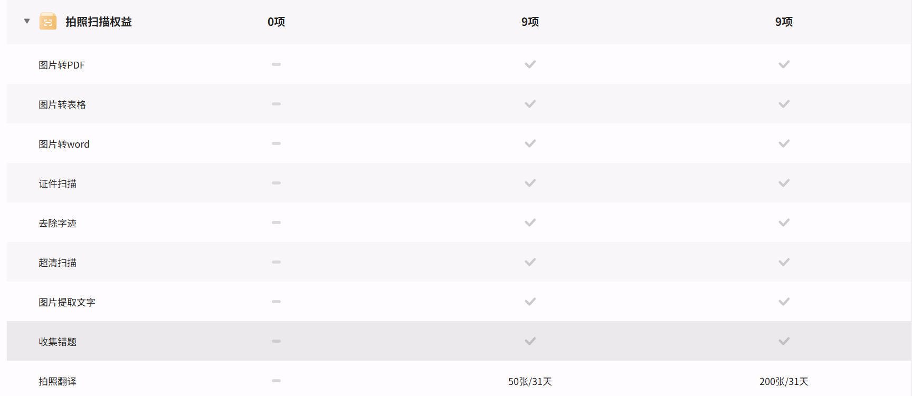
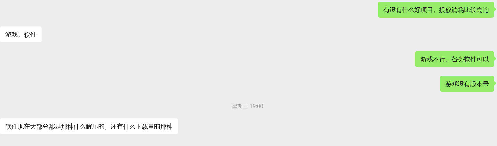
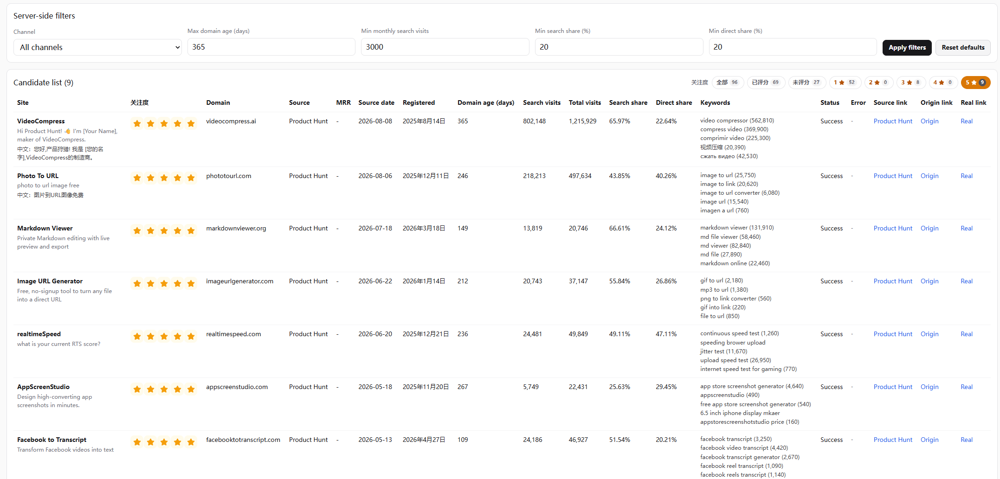
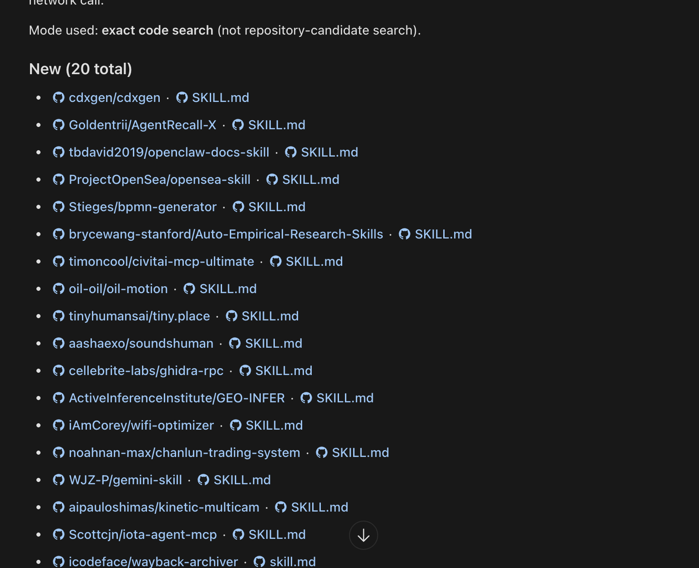

# 你有哪些私藏的挖掘需求的好方法 \- 悬赏专区 \| Web\.Cafe

> 🔗 原文链接： [https://new\.web\.cafe/ask/bounty/fd0\.\.\.](https://new.web.cafe/ask/bounty/fd0wrgx7fh)

> ⏰ 剪存时间：2026\-11\-13 09:44:39 \(UTC\+8\)

> ✂️ 本文档由 [飞书剪存 ](https://www.feishu.cn/hc/zh-CN/articles/606278856233?from=in_ccm_clip_doc)一键生成

[← 返回悬赏专区](https://new.web.cafe/ask/bounty)

# 已结题 你有哪些私藏的挖掘需求的好方法

收藏

大家都知道的，可以不说。需要学习之后，可以直接实操的方法。

赏金池 37,600 投资人 **342 **位 围观 **841 **人

已开榜 · 赏金池 37600 咖啡豆已分出（前三按 3:1:1）

342 位投资人： 

等 342 人

## 回答（23）

[我话事 ](https://new.web.cafe/ask/u/g3p5hqzmw9)🥇 第一名 · 500 分 🏆 分得 22,560 评审均分 7\.7 被 3 位投资人折叠 

扣费前 ¥2256\.00 平台服务费 ¥0\.00（本笔免收） 实际到账 ¥2256\.00

用户愿意付费的产品才是好需求，所以这篇文章就分享一下我是怎么挖到一个年营收百万的需求！

# 一、如何找到一个能赚钱且很容易的需求点?

## 1、哪些产品付费率很高？

哥飞的工具中有一个Stripe引荐流量榜,可以看到网站有多少流量到达付费页。但光看这个你只是知道有谁在赚钱，但你并不知道谁赚钱厉害！ [https://seo\.web\.cafe/referring/ ](https://seo.web.cafe/referring/)我会多看一步：网站访问量/strip页面流量=到达付费页的比例；用这个指标代替付费率，从而可以很好评估这个产品的用户需求是否强烈

以 Higgsfield为例：269\.26 万 ÷ 3131\.87 万 ≈ 8\.60%也就是说，每获得 100次网站访问，大约会产生 8\.6次进入Stripe 收银台的访问。假设:支付页到达率：8\.6％;进入付款页后的支付成功率：50%客单价：50美元；月访问量:10 万 那么：10 万 × 8\.6％ × 50% × 50美元= 21\.5 万美元新增付款金额。但是：1、这不是普通订阅站的行业平均值，进入 Stripe引荐榜的网站本身就很优秀；2、不能只想好的不想差的，以1％的保守值估计。

## 2、广告平台消耗数据

如果你一个产品赚钱很厉害,你是不是想要放大量赚更多的钱？我们就用这个思维来反推那些一直在投放，或者突然加大投放的产品，它的ROI一定是大于 1的，抄作业。 我用过的平台：（1）小红书聚光：可以筛选关注领域的热门素材，可以让你打破信息差，知道在你认知之外的哪些产品正在投放赚钱。类似的还有抖音的巨量

（2）谷歌应用商店和appstore的软件下载量与收入 app\.sensortower\.com ，这个网站可以查看一些下载量和收入数据。我自己实验以及与一个游戏开发者聊过，自查对比过这个数据和内部数据，具体数值是不准的，但趋势范围是对的。比如上面写月收入50K，企业内部真实数据基本就在 40K到 60K 这个区间，不会出现50K 和 5K这种量级的区别。类似的软件：七麦数据、点点数据等等

## 3、淘宝和闲鱼销售数据

我曾经做过一款面向研究生的学习软件。在做用户调研时，我们发现竞品在淘宝和闲鱼上有很多人卖安装包或使用教程，月销量能达到几千份。我们找其中一位店主聊了聊，他提到一个关键点：很多人需要翻译功能。当时我们在想，研究生最基本的六级翻译应该都会吧？谁会要翻译，而且已经有这么多翻译工具。但后来上了这个功能（当然是结合用户的场景和做了细节方面优化），因为大家看的是专业科研论文，信息量大且专业用词多，所以看不懂。例如Zotero 是一个免费开源的文献管理插件，但你发现淘宝上光卖这个插件安装包和教程的都能卖几万份。（而这在GitHub 上有很多免费的开源项目，但是百度上搜不到 GitHub的链接）如果你再结合搜索引擎的一些搜索数据，你会发现用户的需求很强烈\.

## 4、关注一些工具工厂或者大厂会员功能

PDF转 Word、图片 OCR、录音转文字这些需求，你觉得用户会付费吗？能够支撑一个产品的月订阅到 1 千美元的收入吗？ wps你去看看WPS 的付费会员功能，会发现每一个功能都能找到免费开源方案，或者调用API极其简单的实现方式。但想想那些整天兴趣爱好是吃喝玩乐、并不研究工具和效率的人，对他们来说,把 10页PDF 转成Word 就很困难\.如果人们不会为这些功能付费，WPS 的收入是从哪来的？

但也不是所有的都可以做, **优先选择那些高级会员才能用的功能,而且还限制次数、限制用量的功能**

## 5、分享量很高的视频

哥飞的群友，大家做的可能都是需求比较明确、有大量搜索词方向，或者说一个突然起来的新词。我做社交媒体的时候，是否会选择做一个方向，就是评判这个方向爆款的内容是不是分享量比点赞量还高。比如说点赞量 1 万，分享量2 万，那说明这个东西很具有传播力。它是一个吸引人、让人愿意分享的东西。做这个产品，它会降低我营销的成本，会有人自发地去传\.

# 二、挖掘好需求时必须要有的5个认知：

上面说的是怎么找到一个可能很容易就能赚到钱的需求点，下面是一些你自己如何更快的去验证这件事的一些经验和教训。看起来或许比较空洞，但每一个都是我们真用真金白银和时间获得的，虽然没有技法，但是指导思想层面的感悟，让我们尽量做出正确的决策。

## 1、伟大的技术，原始的需求。

AI 技术迭代速度很快，但是人们关于工具的需求迭代很慢，需要解决的问题迭代也很慢。所以有很多Web 时代、移动互联网时代就存在的产品，今天用 AI再做一遍照样能赚钱。

## 2、大模型能实现的功能，不代表所有用户都会用大模型。

比如说，批量生成公众号文章，批量生成发言稿\.豆包、文心一言、Deepseek任何一个产品都能做。但是你去搜索相关的产品 APP，发现照样很多。所以千万不要陷入“大模型有我就赚不到钱”的这种误区。

## 3、先有用户，再开发

错误行为:先有产品，再有推广。 正确的做法应该是在写第一行代码之前，先 Vibe Coding一个页面出来，然后假装你已经有了这个产品,然后你去做 3件事： （1）拿着这个demo去宣传,看能不能有曝光,看能不能在 1个月之内获得几百、几千个用户，验证你的需求。 （2） 在设计页面的时候，不要写“立即预约”，一定要写“立即购买”，哪怕你没有接购买。 （3）不要开发一个完整的功能，用户给扫你个人微信付款，你手搓给用户交付。 甚至，我们不少产品功能不是产品经理想出来的,每个功能做几个不同的 demo页面,然后去分发宣传，看哪个设想的功能点能够吸引用户的注意力，然后我们就按照这个视频里出现的demo 功能去开发。

## 4、便宜是一个坏生意

做工具订阅，如果你不是视频生成、图片生成这种按量计费，最好能够把它包装成按月或者按年订阅的服务,固定价格，不要卖积分，那样你吸引的都是斤斤计较的价格敏感型用户\.当你卖不出去的时候，第一反应不要想着去降价，而是想着自己是不是没有给用户一个合适的理由，让他愿意为你付出更高的价格\.

## 一个很烂的产品都有人付费和夸奖

如果你在社交媒体或者 Vibe Coding 的话题里看到一个产品，你一瞬间觉得：它不就是前端页面吗？不做烂了吗?结果还有人夸奖,你去试用发现它甚至都不成熟、不稳定，那说明这个需求真的很痛很痛\.这么垃圾的产品都有人在用！看到这种产品不要嘲笑它,而是应该敬畏它、学习它。

[benny ](https://new.web.cafe/ask/u/lbe5brh1hd)🥈 第二名 · 481 分 🏆 分得 7,520 评审均分 7 被 1 位投资人折叠 

扣费前 ¥752\.00 平台服务费 ¥0\.00（本笔免收） 实际到账 ¥752\.00

# 分享一个全自动找需求词的方法，不可能找不到词

producthunt 有一个免费 api接口，可以根据日期拿到产品list， [https://api\.producthunt\.com/v2/docs ](https://api.producthunt.com/v2/docs)，那就可以每天请求一次，拿到前一天发布的产品,解析产品的真实网站。

拿到网站后，就可以查 AITDK数据，拿到域名注册日期,流量，流量结构，核心搜索关键词等等数据。

我的筛选条件是:

1、域名注册时间在一年以内（代表新站） 2、月访问量超过 3,000（拿到流量） 3、搜索流量和直接访问占比都超过20%（拿到搜索量且有二次访问证明网站是能解决用户需求的）

当然这里也可以根据 你们自己的筛选标准去改，你都拿到的aitdk 数据，想怎么整都可以。

筛选出网站后,我会继续查看它的搜索关键词，排除品牌词，只看需求词，就是用户寻找解决方案时使用的词

那么整个筛选思路就是：如果一个新站能够拿到非品牌词的流量，相当于这个关键词赛道，不是老站霸占，是对新站友好，现在还有机会的赛道！

接下来只需要判断自己是否对这个方向感兴趣、serp的站点你有没有机会做的比他们好，有把握直接就可以开干,按哥飞的方法拿关键词去做域名。

最后 ，重点是收集榜单，查aitdk，筛选非品牌词整套流程可以放在 Cloudflare Worker上自动运行，做个 cron，每天早上，系统会把符合条件的网站整理出来，具体操作可以ai一下。最后附上一张我的后台截图。

另外，从目前的数据看，大约每 300个Product Hunt产品，才能筛出一个符合我要求的网站，目前我只做了PH 一个站，如果添加更多导航站和榜单，那么就能找到更多需求词\.方法能节省大量前期筛选成本。

[颜飞 ](https://new.web.cafe/ask/u/qzkkrfsd4g)🥉 第三名 · 311 分 🏆 分得 7,520 评审均分 6\.1 被 2 位投资人折叠 

扣费前 ¥752\.00 平台服务费 ¥0\.00（本笔免收） 实际到账 ¥752\.00

我比较懒，所以自己开发了一套 Skill专门做网站，

其中有一个 Skill会自动抓Similarweb 和 SEMrush，只需要我给他任意一个想法或者一个词根，他就能给我找到许多数据，能挖掘到非常多的小需求和小众网站，还有那些新词网站，突然流量暴涨的那些网站。

然后我还在继续拓展这个 Skill的一些能力范围,比如去监测 Reddit、X、YouTube。

而这些最关键的就是拿到词之后，要判断这个词它在市场上确实是有流量的，而且也要判断出来，还有哪些长尾词的竞争压力是小的,更有机会。还要去分析竞争对手们的网站，还有网站的数据\.

还有，它还可以操作浏览器和各飞AI对话。其实很多群里面也提到了不少拉关键词的办法，但我也懒得去看，所以都让 AI去查

我这一套 Skill把所有的环节全部都交给AI自动化了\.

[https://x\.com/yan\_ai\_labs/status/2090785456774689270](https://x.com/yan_ai_labs/status/2090785456774689270)

[程序员卡诺 ](https://new.web.cafe/ask/u/98s31zkqwd)评审均分 7\.2 被 3 位投资人折叠 

虽然问题是求法，但我想给大家讲一条“通天大道”（我认为的，最近验证了这个方向，玩的很爽）

# 首先，卡点真的是没有挖掘需求的方法吗？

> 为避免被判为跑题，我在最后也附了一条最近在验证的方法

其实在社群中翻一翻，你就会发现有很多找需求的方法论

- 比如 去各种榜单看什么网站赚钱，然后调研其满足的核心需求进行复刻

- 比如 我们重点的 SEO，所有的搜索词其实都是需求，由此又衍生出来 去数据网站挖老词,和 google 趋势挖新词的玩法

- 比如 去能直接产生交易的平台（比如小红书笔记、直播挂的商品,闲鱼里卖的商品等），依旧是词根搜一搜什么卖的好，那也都是需求，可以去琢磨上网站

所以其实方法从来都不少，那么问题出在哪呢

# 卡点其实是不能大量的执行枯燥的挖掘方法

看榜单，很少有人能做到看了榜单以后只看其中的第一名，研究了以后立马去执行复刻。一般都会看两个、三个、四个，看完就发现已经不知道要做什么了。

从数据网站挖词，每次搜索出来，你都会看到大量的词儿，然后每个词儿再去研究搜索结果。研究上几十个词你就受不了\.。

而不管是没有时间去执行方法，还是没有耐心去执行方法，总之,不起量你是得不到好结果的

（而像我这种的英语渣,很多方法我都了解过，但是每个我都执行不了几次，全 tm 一屏幕英语，哪怕有翻译，看的我也是很难受）

那在这个 AI 时代，我们为什么不让AI 去干这个事儿呢？

# 讲一下我是如何用 AI 去执行 SEMrush和SimilarWeb 关键词需求挖掘的。

> 其实就是用 agent跑通了 [漫游找词 SOP](https://new.web.cafe/tutorial/detail/fjdhxvvcsq)

首先，我最近完成的挖词逻辑： 1、从社群里找到了119 个词根 2、将词根扩充为1309 个（最后一段讲了逻辑） 3、从 SimilarWeb根据词根扩展出9w\+ 关键词数据（broad\+ suggest） 4、根据KD、搜索量 等，对数据进行初筛 5、让 ai 基于精品工具页的思路，做一道二筛,把明显看起来不像这种机会的词筛掉 6、调用 哥飞的 API和 SemRush来进行数据验证（因为有些词在 SimilarWeb 里 kd 为 0） 7、最后，调用谷歌搜索结果的 API去研究实际的搜索结果（比如用这个关键词做域名的网站多不多等。。。）

以上是我最近做的这个系统的整体逻辑。但如果你只是按上边这个逻辑走，那么你会得到一大坨看着眼花缭乱的数据。

**于是我又让AI专门给我做了一个看板来看这些数据，并按照我的一些要求对数据进行排序分类。**

这样方便人也参与到这个过程中去，对数据的筛选规则进行快速的调节，以及查看调节后的反馈。

## 可以看到，这个事情中非常关键的节点，就是让我的 AI agent能拿到某个领域的数据。

- SimilarWeb

- SemRush

- google搜索结果 [serper\.dev](https://serper.dev/)

- [关键词难度估算\(哥飞版\)](https://seo.web.cafe/kd/docs)

其中SimilarWeb 和SEMrush，他们官方有 API,但是都比较贵，我的解决方案是把我用来查这两个数据的网站里的api，做成本地的 mcp给我的ai用，这种技术严格来讲被称为逆向

> 我跟AI 是这么描述的： “你看一下我现在chrome 上的这个网站，我有这个网站的会员账号，里头也有很多额度，但是他们没有提供给 AI 使用的 MCP。我希望你帮我把这个网站的 API 捞出来，使用我的会员登录信息,做成我本地使用的MCP，供我的 Agent 调用。 （我之前用的是codex \+ gpt 5\.6 sol ultra，通篇没有提逆向这俩字，ai 哐哐干完了也没拒绝我）

## 这套逻辑解决了最痛的 方法论执行问题

我跑了 1309 个词根，扩出来 97681 个词，然后过了两道筛选,最后还剩下 800 多个词

如果不是用 ai \+ 代码，人力能搞定这套的我只能说活该他成功😂

## 一些心得：

1、不要追求全用代码解决所有链路

中间需要agent ”人肉”调度的，那就让 agent来，如果 agent都搞不定的，那把自己也填进去也没问题

最后筛选剩下的800 多个词，我就打算在多维度验证一下，不行就我和ai配合给吃掉，这个体量还是可以的

2、机会很多，合理设定筛选，不要怕浪费

比如我这次的筛选目标，是：精品工具页 \+ 关键词域名

所以我定的初筛条件是 KD 很低，搜索量不用很高,有点cpc 就算ok 的那种，有不少是每个月几千刚过万的搜索量，但如果我能用一下午搞定一个工具页扔上去，那也可以不是？

以后有时间了，也可以去筛那些 kd 更高，且搜索量更大的词，不同的目标不同的策略

3、AI时代，要把 ai 融入方方面面

后续我会再去拓展更多的筛词思路，比如对新词的监控，对应的我也需要收集更多的数据源头,比如grok 可以查询x的数据，那么这一点就一定程度可以利用上

## 最后，我这次找词的额外方法论

大家都知道词根可以扩展出搜索关键词，大家也知道可以用 ai 把网站翻译成各种语言

那么有没有想过，我们社群里的所有关键词词根，都是英文呢？

但是我作为中国人，我肯定是搜索【JSON 编辑器】而不是【JSON editor】吧？

所以多语言词根,就是我要补充的【挖掘需求方法】

但是多语言\+词根，也带来了量的倍增，所以人力真的有限,只能上 ai 了

1、挖长尾支付网关的入站流量，重点反查 Creem、LemonSqueezy 这类专精于小微商户的支付网关，不要只盯着 Stripe 和 PayPal 这种巨头。使用这类产品的往往是个人开发者或极小规模的团队，他们的入站流量里藏着大量可以直接对标、甚至快速复刻的利基产品

2、拆解应用商店的付费榜单与差评：直接去拆解iOS 和Google Play 的榜单，特别是利用七麦数据（qimai\.cn）等工具深挖付费榜\.能长期挂在付费榜上的应用，说明其核心诉求已被市场验证，且用户有极强的付费意愿。重点研究它们的差评——用户反复吐槽的痛点,往往就是新产品的绝佳切入机会

3、定期爬取并监控竞品或头部站点的 sitemap\.xml 可以第一时间发现他们新布局的长尾词页面或新上线的子产品线，直接获取他们花重金或时间调研来的流量需求

4、监控 V2EX的“分享创造”或“发现”板块，以及Product Hunt 等社区\.重点提取里面的出站链接

5、下沉挖掘内容社区的非标需求：小红书、即刻等内容平台是挖掘 C 端情绪价值和工具需求的绝佳场景。原理同上，通过搜索特定痛点关键词如“求推荐”这种,观察爆款笔记的评论区或博主引流的外部链接

6、客座博客里面拉价格100 刀左右到看里面都什么人在发什么站。。

就这些了，先这样吧

我的一个方法，是去GitHub 和 X（Twitter）上反向搜索别人分享的Skill。相比SkillHub里偏通用的模板，这些 Skill 往往来自真实工作：作者先遇到一个反复出现的问题,再把解决过程沉淀成SKILL\.md\.比如我见过不少“去除AI味”“模仿个人写作风格”“自动整理会议纪要”“生成特定格式周报”的 Skill，背后对应的都是很具体的需求。 在GitHub 上，可以搜索filename:SKILL\.md、path:skills SKILL\.md，并按最近更新时间排序。不要只看Star 数，新提交、低Star的个人仓库反而更容易发现新鲜需求。还可以进入作者主页，看看他最近提交了哪些自动化工具。 在X上,我会搜索 "SKILL\.md"、"my skill"、"Claude skill"、"Codex skill"，重点看回复区、引用转发和收藏量。可以直接把上面的内容给你的 codex让他每天去筛新的，比如下面图片这样，筛完后让他用中文给你总结这些都是干嘛的，人工再筛一些。接下来就是把这些功能对应的关键词去 smerush等去搜了，看有没有流量

这里找需求核心是公式是：成熟市场 × 已验证需求 × 明确痛点 × 某个细分人群 × 可以明显改善\.所以，要找已经被验证的需求了，例如找各种榜单,看对应的收入排行以及 stripe 等各种支付网关链入的网站等，这些是群类已经常用的一些方法了。 这里群内之外可以尝试的一些方法： 一、可以找对应的差评等 平台 适合研究 Trustpilot SaaS G2 B2B SaaS Capterra B2B 软件 App Store移动应用 Google Play Android应用 Chrome Web Store浏览器工具 Shopify App Store 电商SaaS WordPress Plugins 网站工具 Reddit 非结构化真实吐槽 Discord 高频真实使用问题

这些都可以去看相应的差评可是用户量还可以的一些工具等了，这里我们可以看一下对应的 web 的搜索的关键词，基于关键词理解对应的意图,之后可以做对应的 web网站来承接对应的需求了。

二、社区「许愿句式」挖需求 site:reddit\.com "is there a tool that" ai video

site:reddit\.com "I wish there was" video generator

site:reddit\.com "does anyone know a" image to video

site:reddit\.com "how do people make" ai ads 搜索reddit相应的一些许愿句式的帖子等，包括 TAAFT等同样有一些许愿式的需求。另外，这里还有 facebook等账号，可以加入对应的AI 社群等，这里即可以找到对应的用户，可以找机会推广自己的工具，同时可以直达用户,找到对应的用户需求了，当你能够回复对应的用户需求，并且在自己已有的网站上做一个页面去满足用户需求的话，这样的转化率是非常高的了。

三、找已经有人花钱的地方了 Fiverr、Upwork、Freelancer等这些都是可以接外包的地方了，这里可以看用户愿意为哪些需求花钱，这里找到对应的外包项目，看哪些是我们可以做saas来承接的了，这些可能是有相应的共性的地方了。

四、Chrome Extension 需求挖矿 这是做 Micro SaaS / 工具站非常值得研究的一条线。 重点寻找：用户很多,但是评分不高。 例如： 100K\+ users 500K\+ users 1M\+ users 但: 3\.5 ～ 4\.3 分

这是一个非常漂亮的信号： Validated Market \+ Bad Execution 即：市场已经存在，但产品执行不好。 然后看评论里的：Doesn't work with\.\.\. Please add\.\.\. Too expensive Slow Stopped working Privacy Wish it could\.\.\. No longer works Need bulk\.\.\.

尤其是： “I love this extension, but\.\.\.” 价值非常高。

这里需求会有很多，最好找相应的天花板比较高的，之后能够深入一个方向来做相应的网站了，这里做一个月入一万美元的网站可能会比做 10 个月入 1000 美元的网站更加聚焦了，而且网站能够不断积累，有自己的用户群体之后，把老客户维护好，同时，要做高客单的，一个月订阅30美金，只需要 300 个客户就可以接入月入1 万美金了，seo 加全球的社区、以及facebook、twitter等找到你的 300个愿意支付的用户,并维护好。 希望各位能够多多点赞和投票哈，多谢各位。祝愿投票支持者早日月入万刀，大家一起出海赚美金\.

[GONG ](https://new.web.cafe/ask/u/7r7gjwhh65)评审均分 6\.1 被 3 位投资人折叠 

需求太广太多,本次回答聚焦到订阅站，挖掘需求落地就是找词。

一句话，构建以【词根】和【榜单】为核心的【找词闭环】。

1、第一条路：把这个以哥飞51 个经典词根为基础的扩展词根库拷下来,大概 100 个，作为自己的初始词根库。 [https://swmedbueei\.feishu\.cn/sheets/UZpGshLvKhq7MdtQOFycstuUn4e](https://swmedbueei.feishu.cn/sheets/UZpGshLvKhq7MdtQOFycstuUn4e)

2、用 AI做个 similarweb 自动批量获取脚本，以【词根】关键词扩展，查询下载搜索量3 万以上/KD 60以下的所有词。

3、第二条路：把每个月的 Stripe 收入榜/Toolify收入榜的网址采下来。

4、用AI 做个similarweb自动获取脚本，查询下载搜索量 3 万以上/KD 60以下的所有词，这时候发现很多词殊途同归。

5、接着用AI 做个能查询哥飞 KD 和关键词解释（提示词：是什么/有什么搜索意图/有哪些商业价值）的插件，每天手动看300个\.

6、慢慢就会发现越来越多能做的词，选当前最好的词，每两周做一个，每天每个站发 5 个外链\.

7、从这些词中再提取出新的词根，更新词根库，形成闭环。

# 日常挖掘产品需求的几个方法

分享几个我日常会关注的需求挖掘渠道：

## 1\. Product Hunt 榜单

关注每天参与榜单的新产品，重点了解：

- 产品解决了什么问题

- 面向哪些目标用户

- 产品的点赞、评论和排名情况

- 评论区有哪些用户反馈和潜在需求

地址： [Product Hunt](https://www.producthunt.com/)

这里也推荐一下我们的 Product Hunt 需求挖掘Codex Skill，可以辅助整理每日榜单并分析潜在的产品机会:

[Product Hunt Ideas Skills](https://github.com/flaqai/product_hunt_ideas_skills)

## 2\. GitHub Trending

关注近期增长较快的开源项目，看看哪些技术和产品方向正在升温。

除了Star数量，还可以查看项目的Issues，从安装复杂、缺少界面、功能不足等反馈中寻找产品化机会。

地址： [GitHub Trending](https://github.com/trending)

## 3\. Hacker News

关注最新的创业产品和技术趋势，尤其可以多看看 `Show HN` 、 `Ask HN` 以及评论区。

这里的用户讨论相对深入，比较容易发现现有方案的问题，以及开发者和创业者的真实需求。

地址： [Hacker News](https://news.ycombinator.com/)

## 4\. AI 工具及流量榜单

### Toolify

关注开发者最近提交的AI工具，观察哪些细分方向开始出现更多产品。

地址： [Toolify New](https://www.toolify.ai/new)

### Traffic\.cv

从流量增长的角度观察新产品，判断哪些网站不只是获得曝光,而是真的开始获得用户\.

地址： [Traffic\.cv](https://traffic.cv/leaderboard/traffic/2026/7/new)

## 5\. Reddit 社区

关注SaaS、Startup、SideProject、Entrepreneur 等相关社区，了解用户自荐的新产品，以及大家对现有工具的吐槽、替代方案推荐和实际使用反馈\.

尤其可以留意以下内容：

- 有没有工具可以解决某个具体问题

- 某个产品太贵、太复杂或不好用

- 用户正在寻找某款产品的替代方案

- 创业者分享为什么开发某个产品

## 使用 AI 定期整理

以上渠道可以交给 AI每天定期收集和整理，按照自己的关注方向生成日报，例如：

- 今日新产品

- 增长较快的项目

- 用户高频痛点

- 现有竞品及不足

- 值得验证的需求点

需求挖掘的关键不是简单追热点,而是寻找那些被反复提及、现有方案仍然不够好，并且用户愿意付费解决的问题。

1 人觉得赞 

[祥子 ](https://new.web.cafe/ask/u/lg54yyjvvq)评审均分 6\.9 被 3 位投资人折叠 

[日出东方 ](https://new.web.cafe/ask/u/hts1k9h1b4)评审均分 6\.4 被 4 位投资人折叠 

一、GSC 落地页 × 停留时间交叉表

只看流量是浪费。

要把GSC的"搜索词 → 落地页"和GA的"停留时长 \+ 跳出率"拼起来看。

找 高曝光 \+ 高点击 \+ 低停留 的组合。

这类词含义很明确：用户带着明确期待搜进来了，我没给到他要的东西。

不是需求不够，是需求已经被确认存在,我正在浪费它。

我有一个工具就是这么挖出来的，但只做了一次。现在每周有两百多人用免费功能，这张表里肯定还躺着好几个没做的工具\.

实操： GSC导 28天"查询\-页面"数据 → GA4导页面停留时长 → 按落地页join → 筛点击 \>10 且停留 \<30 秒 → 逐个看这些搜索词到底在问什么

二、竞品的"付费墙位置"逆向法

我之前建的竞品数据库，记的是支付平台、定价、免费额度、Upsell——这些都是表面。

真正的信息在一个地方：竞品把付费墙放在哪一步？

付费墙的位置，是竞品用真金白银试出来的"用户愿意掏钱的那个瞬间"\.他们已经替我做完了A/B测试，答案就明晃晃写在页面上。

输入信息后立刻收 → "生成结果"这个动作本身值钱 给了摘要之后才收 → "完整性"值钱 第二次访问才收 → "持续性"值钱 只在某个特定问题上收 → 那个问题最痛

这条直接对应我现在的问题:两百多人用了免费功能，一个都没付钱。很可能是我的免费部分给多了，用户在走到付费墙之前就已经满足了。

三、退款和差评理由，是最贵的需求信号

我有 2 个退款用户，其中一个的理由是"找不到联系方式"。我加了入口——但这个信号只用了一半。

退款和差评，是唯一由用户自己掏钱之后给出的反馈,可信度远高于任何免费调研。

放大到竞品身上：去看竞品的差评、退款吐槽、Trustpilot、Reddit抱怨帖、Chrome 插件评价、App Store评价\.

用户骂竞品什么，什么就是没被满足的需求。

功能列表告诉我"他们做了什么"，差评告诉我"他们做了但没做好的"——后者才是我的机会。

四、把"用户已经在付钱的替代方案"当需求证据

最硬的需求证据不是搜索量，是已经有人在为这件事掏钱了。

我的赛道里，有人愿意花几百上千去找人咨询——这就是需求存在的铁证，比任何关键词工具都可靠。

值得研究的是两件事：

他们具体是在什么场景下掏的钱？ 这个场景怎么搬到线上？

大概率不是"我想知道一个结论"，而是"我最近有个决定拿不准，需要有人给我一个说法"。

如果这个判断成立，那我缺的不是更多工具，是\*\*"被回应"的感觉\*\*。

[李大山 ](https://new.web.cafe/ask/u/r8xm1556mm)评审均分 6\.1 被 3 位投资人折叠 

延展法：一种挖掘产品机会、寻找赛道需求的实操方法

这个思路和哥飞提到的「词找站、站找词」有共通之处，我把它命名为延展法。

核心逻辑：先锁定一个已经被市场验证过的单点需求，再围绕这个中心点，顺着整条业务流程、场景、细分维度向外延展扩散，梳理出整条链路里面现存的痛点，从中挖掘出新的可落地需求。

举一个我做AI SaaS 出海时的真实案例： 去年三月刚开始做ai 出海的时候，当时我观察到已经跑通的产品，像AI‑headshots（AI职业头像）、AI‑hair‑generator（AI头发生成）这类工具，已经拿到了真实流量，相信大家也见到过，证明“生成人体局部图像”是一个成立的市场需求。 以此作为原点向外延展：既然可以做 AI 头像、AI 头发，那能不能延伸到身体其他部位？顺着这个思路，衍生出AI‑face‑generator、AI‑hand‑generator、AI‑foot‑generator等一系列关键词与产品方向。 顺着这条线索，我找到了Footgen\.com，这个站点当时已经做到了月访问量20万，当然它有点擦边，就是单点需求延展之后诞生出来的成功产品\.

实操思路总结 找到一个已经被市场验证的需求原点，以它为中心，沿着场景、流程、细分维度做横向、纵向延展，批量挖掘潜在痛点、衍生关键词与全新的产品机会。 不管身处哪个行业，都可以套用这套方式，从一个成熟单点向外扩散，找到还没被充分开发的需求。

以上内容为口述给豆包并整理文字。

[清仔 ](https://new.web.cafe/ask/u/48g95hisn4)评审均分 6\.9 被 5 位投资人折叠 

[Dawn ](https://new.web.cafe/ask/u/95vknfde5h)评审均分 5\.9 被 3 位投资人折叠 

说一个我经常会实践的办法 1\.针对 toolify 榜单与taaft 榜单，找到自己产品类别的榜单站点，或者自己想做的产品类别的榜单站点。然后批量抓取这些站点的 sitemap。将sitemap 和站点统一喂给 AI，让他深入了解这些站点的功能，分析这些站点主要都在做什么。然后跟自己的站点功能做深入对比,看看自己的站点缺少哪些功能，让AI 去批量复刻上功能。这个适合已有站点快速发掘需求上线内页。我通过这种方式将站点流量从每日 100左右点击，提升到了 1000点击。

2\.看自己站点后台的GSC，让 AI 分析所有的搜索词，看看有哪些需求没有满足，找到新的需求。然后让 AI深入搜索，广泛调研，实现这个需求。

[黄楚标 ](https://new.web.cafe/ask/u/yrbtncnxpw)评审均分 6\.2 被 3 位投资人折叠 

最值得实操的8 个方法：

1. 看低评分：专门找 1\~3 星评论，提取“为什么不好用”。

2. 看代做服务：Fiverr、闲鱼等,找别人已经付钱让人解决的问题，比如英国验证的ASCP 个人代验证。。

3. 看招聘JD：大量招聘某个重复岗位 = 企业正在用人工解决的问题，比如未来 AI落地实业的项目工程师。

4. 看超长教程：一个事情要20～30 步才能完成 = 很可能可以产品化。

5. 看Excel 黑洞:复杂、重复、每周手工维护的 Excel = 半成品 SaaS。

6. 看工具拼接：用户同时用ChatGPT \+ Excel \+ Canva \+ 其他工具 = 可以考虑“一体化”。

7. 看迁移需求：搜索 alternative / replacement / migrate / too expensive，这类用户已经有明确需求。

8. 看异常价格：一个看似简单的工具却有人愿意付 $20、$50、$100/月，说明它背后解决的是商业流程。

我觉得最核心的判断公式

需求价值 ≈ 痛苦程度 × 发生频率 × 付费能力 × 当前解决成本，如果可以，大家可以使用谷歌广告，使用谷歌官方广告透明度中心： [https://adstransparency\.google\.com/ ](https://adstransparency.google.com/)输入对方网站/品牌名，就能查到对方正在投放的广告素材、投放地区，比如输入热门的网站，会找到对应的广告认证主,这样可以马上知道一个广告主体以前和现在投放了什么广告素材，进入网站后，查看具体的着陆页,并查看对应的 CTR，如果一些产品有评价，还可以找到对应痛点或者差评来做自己的产品，踩着别人花钱得到的结果复刻优化深挖某个需求点。

2 人觉得赞 

[前行 ](https://new.web.cafe/ask/u/1wzyxrlck7)评审均分 5\.5 被 3 位投资人折叠 

社群里已经讲了很多，我讲几个有点区别的： 1，最近跟不少朋友聊天，发现不少刚入行做 ai工具站就能快速变现的朋友，挖掘的需求其实是从身边的人入手的\.

比如本身自己是做电商的，每天都需要处理一些重复，枯燥，麻烦的事，后面就让 ai搭建了一个自动化流程，解决了这个问题，提高了效率。

随后跟身边的电商朋友分享，很多人纷纷付费尝试,冷启动就完成了,后续就是不断优化。

所以，很多跨界的朋友可以先想想自己原来的行业有什么痛点，然后做出一个产品,找到行业的朋友试用，这可能会更加快速跑通流程。

2，ChatGPT有个定时任务功能,每天让它推荐3个已经经过市场验证的产品,每个产品都具体分析好评，差评，可以切入的细分方向，可做的关键词，长尾词。

得到这些关键词后，我们就可以按照社群的方法去分析关键词了。而且也可以分析产品的网站，看看是哪些关键词获得流量。

这个方法可以让你看到很多想不到的需求。

[Adrian ](https://new.web.cafe/ask/u/cguzgpquc1)评审均分 5\.5 被 14 位投资人折叠 

[袁锐钦 ](https://new.web.cafe/ask/u/u5mtmq7iwr)评审均分 5\.9 被 23 位投资人折叠 

用中文平台当探测器。国内卷得早，小红书 / 抖音 / 闲鱼上验证过的需求，搬到英文市场往往还是一地垃圾站。

1. 小红书搜索框 输入领域词，记下拉联想（用户高频搜索原话）→ 点进看笔记数（供给）\+ 头部赞藏（需求）。笔记少 \+ 赞藏高 = 最优机会。评论区高频问「用什么工具」= 工具站需求\.

2. 抖音搜索框 搜领域词，看头部视频播放量 ——10w\+ 且多条 = 需求有流量。评论区「求链接」「在哪买」= 变现信号。有直播间在卖 = 商业闭环已跑通\.

3. 闲鱼搜索框（最硬） 搜领域词，看 「想要」数vs 商品数 。想要多、商品少 = 供不应求。有人卖 \+ 有成交 = 有人愿意花钱。服务类需求（如「AI 去背景代做5元 / 张」）→ 对应英文工具站机会。

4. 招聘 JD 反推 BOSS直聘 / Indeed搜「领域词 \+ SEO / 内容 / 增长」，看多少公司在招。多家同时招 = 方向起量。JD高频词 = 行业用钱解决的问题。

5. YouTube评论区确认 中文验证过的词翻译成英文，搜 YouTube 头部视频 —— 有播放 = 英文有需求。翻评论区找 「Is there a tool for\.\.\.」：需求在、供给缺，用户原话就是你的页面标题。

长话短说，支付渠道就分析哪些域名在赚钱，大家可能只了解 PayPal 还有 creem,还有Stripe、Paddle 那个,我们还有更多的 mor渠道:Lemon Squeezy,FastSpring,Dodo Payments，woff。可以看看其他的平台。例如你想搞nsfw，你找到一个这样的平台,支付看下他走的什么支付渠道。你同理分析下他的支付子域名或者路径，就可以看赚钱的产品。还有你知道了一个产品。你就能用看流量平台，分析同类型域名，你就能挖掘更多。还有国内，例如，个人无执照：虎皮椒、PayJS，这种支付渠道就分析。还有其他国家支付渠道。不要介意细节，给你提供这个思路\.你看还有广告平台去分析，同样去分析哪里跳转过来的多，这个还没实践你去测试。

[Zhou\. ](https://new.web.cafe/ask/u/epcy76wbbt)评审均分 5\.6 被 33 位投资人折叠 

1\.看谁已经收到钱 找正在收费的小工具，研究用户到底为什么付费。别照抄产品，抄它背后的用户任务和收费点。

2\.找用户正在用的“笨办法” 特别关注复制粘贴、Excel 整理、多个工具来回切换、反复人工检查。用户越嫌麻烦，越可能有工具机会。

3\.看竞品最近在做什么 查看竞品 Sitemap 和最近新增页面。哪类页面连续增加，说明它正在对这个方向下注，再去验证有没有真实需求。

1\.找搜索结果“不对路”的词 用户明明想计算、生成、转换或下载，但搜索结果全是文章和论坛。这通常意味着需求存在,但好用的工具还没出现。

5\.研究任务的前一步和后一步 一个工具完成了核心任务，用户之前还要准备什么？之后还要导出、检查、分享什么？这些小环节往往竞争更小。

最简单的判断公式: 有人反复做 \+ 现在很麻烦 \+ 已经有人付钱 = 值得验证的需求

1 人觉得赞 

[峻菁 ](https://new.web.cafe/ask/u/lhmycqi5jh)评审均分 5\.2 被 10 位投资人折叠 

用 51个词根去反复搜索similarweb，然后交叉对比哪些词是新出来的。再对这些新出来的、流量上升的词，以及最近28天流量比较大的词，去验证谷歌趋势、SERP搜索量和 intitle 搜索量，并判断KD。 还可以基于自己不断搜索总结下来的数据库（比如Excel 表格）去判断：某个词在 1\-2个月前，搜索结果数量是否呈匀速递增的状态，以此作为依据来判断它是持续递增的。 用这些词去搜索的话，在谷歌的首页就可以看：

1. 有没有这个词作为主页主域名；

2. 这个词有没有作为内页去做；

3. 这个词的 KD 如何。

这都是一些判断标准,能让自己去决定是否要做这个词。

最后，再来决定要不要做。

当你在刷小红书等等……各种带推荐流量的平台，发现别人晒自己做了xx工具,这个笔记流量很大，点赞的人很多,评论感兴趣的人多，最好是骂的人少、说“求你别再做这个了”的人少、说“这也太简单了吧”的人看 ta 主页是写代码/用ai很多的人。

如果你也觉得这个工具也太简单了，不就是xxxx 吗，你也能做，轻轻松松就能搞定，甚至你的内心也在想，“就这？”

那么这个工具解决的问题，或者做这个工具本身，大概率是个优质的需求。

产品定价多少不一定，但它一定是对应一个一眼看懂，需要的人（而且数量不少）一看就觉得，我需要这个东西，的需求。

需求具体，人群画像也有了（能推导出定价了），甚至社媒营销策略也有了。

1 人觉得赞 

[楓之随刃 ](https://new.web.cafe/ask/u/8av6frvbbk)评审均分 5\.2 被 5 位投资人折叠 

除了飞哥教的 词找词，词找站，站找词，站找站我经常找的是小红书、抖音商城、拼多多、亚马逊/App Store/Google Play的评论区，搜相关词，相关衍生需求，看 1星和 2 星差评\.差评里抱怨的，就是现有产品没满足的真痛点。这是真正验证过的需求，能满足提供相应工具、优化、服务,那就能吃这块肉

还有就是专业人员的抱怨,很多细分行业，比如女生化妆出片相关的，针对特定人群,特定专业的内部痛点，有时候不在圈内不会了解具体需求，需要找对应人多聊，多了解，在具体行业，一个个具体的人身上找到相应的需求，对于行业外的人不了解就根本不知道说的是什么，也就发现不了。

1 人觉得赞 

回答目录 · 23

1. 

2. 

3. 

4. 

5. 

6. 

7. 

8. 

9. 

10. 

11. 

12. 

13. 

14. 

15. 

16. 

17. 

18. 

19. 

20. 

21. 

22. 

23. 

- 

- 

- 

- [潘正强](https://new.web.cafe/ask/u/jlpcw9tj4u)

- 2026\-08\-25 17:54 08\-25 17:54

- 回复

- 

- 不懂分析数据的出海人都是在假装做产品

- 

- 

